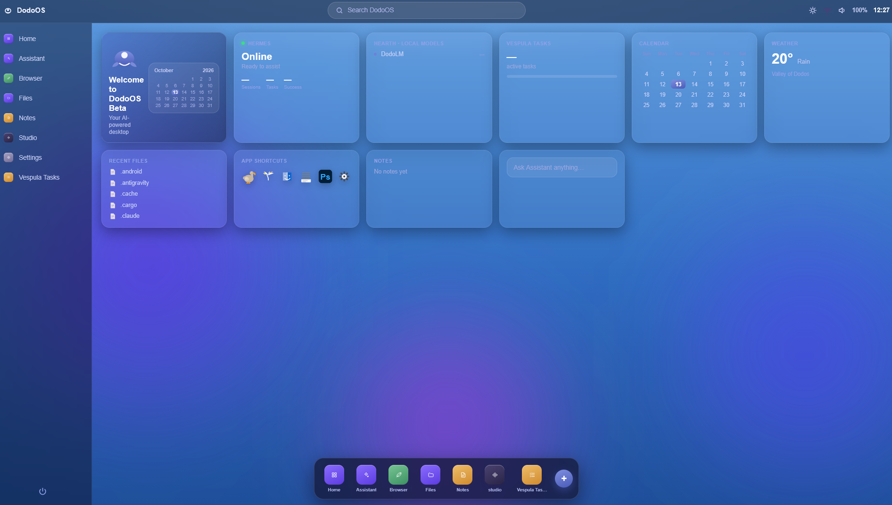

# Tony Wong

### IT service leadership · AI solutions · Enterprise automation

I build practical AI and automation tools informed by 18 years in IT, including 10 years leading services for a global pharmaceutical client across New Zealand, the UK and the US. My work combines hands-on delivery with the operational experience needed to support people, manage change and take responsibility for outcomes.

This portfolio brings together enterprise implementations and independent projects. It describes the problems they address and the capabilities they demonstrate. Application source code and implementation details remain private.

[LinkedIn](https://www.linkedin.com/in/tony-meunier-wong-7b124a20/) · [Zentorin](https://zentorin.co.nz/)

## Selected projects

| Project | Focus | Status |
| --- | --- | --- |
| [AI Recruitment Assistant](projects/ai-recruitment-assistant.md) | HR decision support; approximately 60% less manual CV review effort | Enterprise production implementation |
| [Automated Onboarding & Offboarding](projects/onboarding-offboarding.md) | Employee lifecycle automation and enterprise integration | Enterprise production implementation |
| [Multi-Agent Assistant & Memory](projects/multi-agent-assistant.md) | Everyday assistance with persistent context | Independent, live |
| [Vespula](projects/vespula.md) | Coordinated AI agents with human oversight | Independent R&D |
| [Dodo OS](projects/dodo-os.md) | Cross-platform desktop productivity with integrated AI assistance | Independent R&D |
| [AI Production Harness](projects/ai-production-harness.md) | AI reliability, evaluation, monitoring and governance | Independent R&D |

### AI Recruitment Assistant

Designed, built and deployed a desktop application for HR that supports candidate review and shortlisting. Adopted across an organisation of approximately 200 staff, it reduced manual CV review effort by approximately 60% while retaining human review of recommendations.

**Demonstrates:** business problem discovery, AI integration, practical delivery and measurable operational improvement.

[Read project overview →](projects/ai-recruitment-assistant.md)

### Automated Onboarding & Offboarding

Delivered an automated employee lifecycle solution connecting staff requests with account provisioning and access removal. The work improved provisioning speed, consistency, compliance and audit readiness.

**Demonstrates:** enterprise systems integration, process improvement and operational governance.

[Read project overview →](projects/onboarding-offboarding.md)

### Multi-Agent Assistant & Memory

Built a working assistant supporting email, notes, research and browser-based tasks, with long-term memory to retain useful context across interactions.

**Demonstrates:** operational agentic workflows, continuity and practical AI assistance.

[Read project overview →](projects/multi-agent-assistant.md)

### Vespula

Designed and developed an experimental platform for coordinating multiple AI agents on tasks, with support for different model providers and human approval of actions.

**Demonstrates:** AI system design, agent coordination and human oversight.

[Read project overview →](projects/vespula.md)

### Dodo OS

Designed and developed a cross-platform desktop environment combining AI assistance, integrated applications and productivity tools in a unified user experience.

**Demonstrates:** product development, user experience and AI application integration.

*Dodo OS desktop dashboard — development build, October 2026.*

[Read project overview →](projects/dodo-os.md)

### AI Production Harness

Developed a reusable engineering framework focused on evaluating, monitoring and governing AI applications and autonomous agents. It brings reliability and quality controls into the development process.

**Demonstrates:** production AI engineering, evaluation, observability and operational accountability.

[Read project overview →](projects/ai-production-harness.md)

## Experience behind the projects

My background includes global team leadership, IT service delivery, incident and change management, customer experience, enterprise project delivery, executive engagement and board-level reporting. Since 2020, my work has expanded into enterprise automation and practical AI solutions.

I use AI heavily in research and development, review the resulting work and take responsibility for what I deliver.

## Project evidence and access

The [Dodo OS gallery](projects/dodo-os.md#screenshots) includes desktop and Tasks screenshots from the October 2026 development build. Project discussions and walkthroughs can be arranged during an interview, subject to confidentiality and the availability of the relevant system. Enterprise projects are described without client data or internal material.

Source code, detailed architecture, prompts, configuration and proprietary implementation methods are not published here.

## Contact

Based in Auckland, New Zealand. Available for permanent or contract opportunities, remote or hybrid.

Contact me through [LinkedIn](https://www.linkedin.com/in/tony-meunier-wong-7b124a20/) or [Zentorin](https://zentorin.co.nz/).
