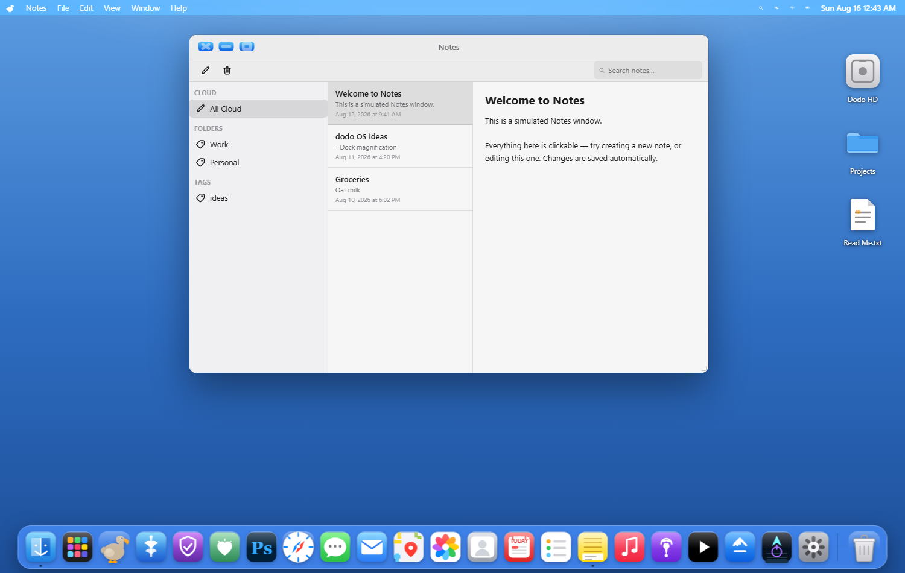
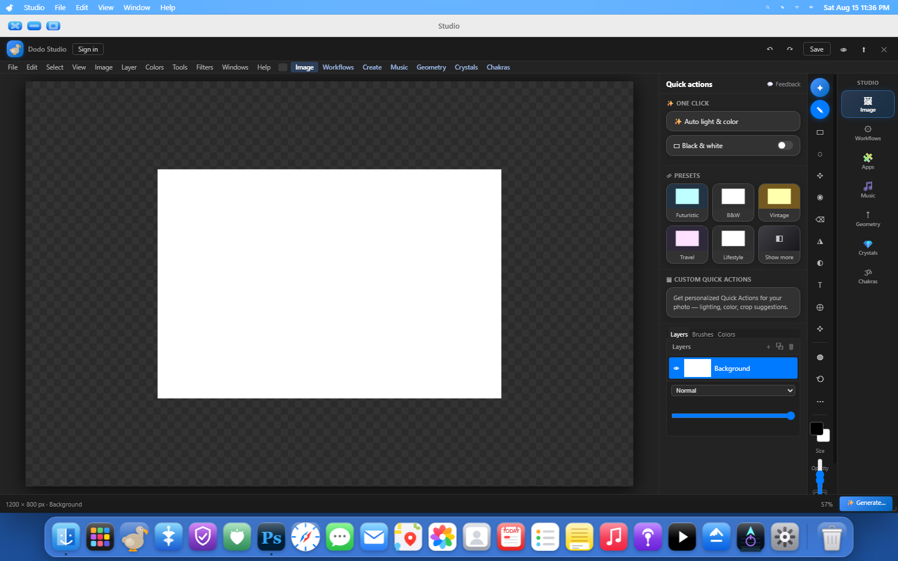

# Dodo OS — AI-Native Desktop Platform

**Independent R&D · Cross-platform desktop application**

## The problem

Productivity work is spread across applications, tools and separate AI conversations. Moving between them interrupts the flow of work.

## What I built

Designed and developed a cross-platform desktop environment combining intelligent assistance, integrated applications and productivity tools into a unified user experience.

## Why it matters

The project explores how AI assistance can become part of the working environment and how a consistent experience can be delivered across platforms. The project remains in independent development.

## Capabilities demonstrated

- End-to-end application and product development.
- User experience design across integrated functionality.
- Cross-platform delivery and practical testing.
- Incorporating AI assistance into everyday software.

## Screenshots

These screenshots show an earlier development build from August 2026, using sample interface content.

### Desktop and Notes

The desktop shell, application dock and integrated Notes interface.

### Dodo Studio

The integrated creative workspace, showing image editing controls, layers and quick actions.

Source code, internal architecture, integration methods and configuration remain private.

[← Back to portfolio](../README.md)
