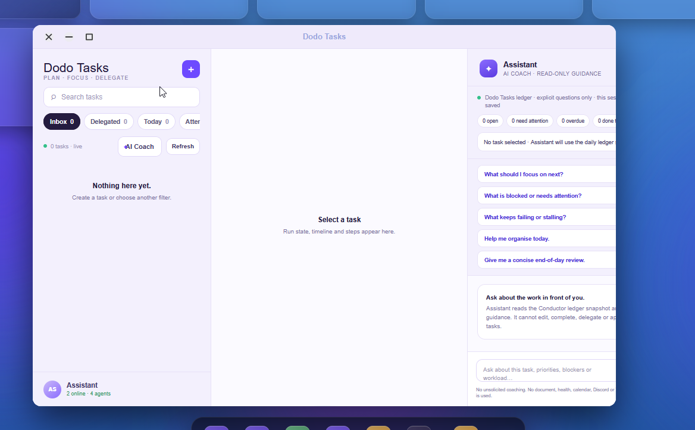

# Dodo OS — AI-Native Desktop Platform

**Independent R&D · Cross-platform desktop application**

## The problem

Productivity work is spread across applications, tools and separate AI conversations. Moving between them interrupts the flow of work.

## What I built

Designed and developed a cross-platform desktop environment combining intelligent assistance, integrated applications and productivity tools into a unified user experience.

## Why it matters

The project explores how AI assistance can become part of the working environment and how a consistent experience can be delivered across platforms. The project remains in independent development.

## Capabilities demonstrated

- End-to-end application and product development.
- User experience design across integrated functionality.
- Cross-platform delivery and practical testing.
- Incorporating AI assistance into everyday software.

## Screenshots

Screenshots supplied by Tony Wong on 13 October 2026, showing the current development build.

### Desktop dashboard

The desktop dashboard, navigation and application dock, with panels for assistant status, local models, tasks, calendar and notes.

### Dodo Tasks

The task workspace with inbox filters, task selection and an assistant panel for planning and reviewing work.

Source code, internal architecture, integration methods and configuration remain private.

[← Back to portfolio](../README.md)
